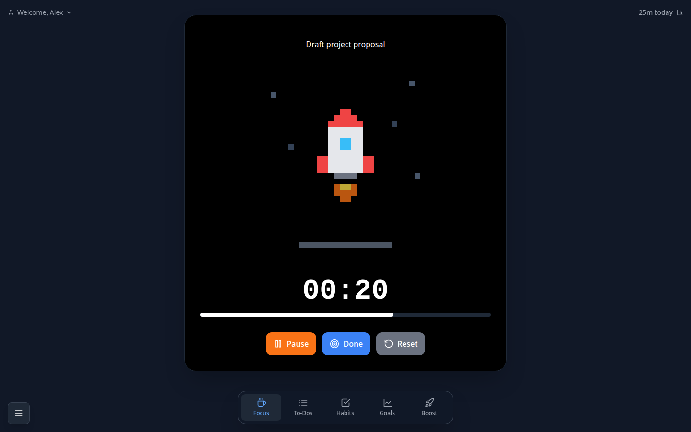
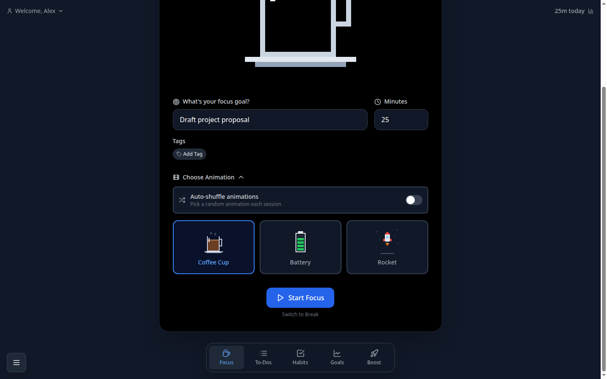
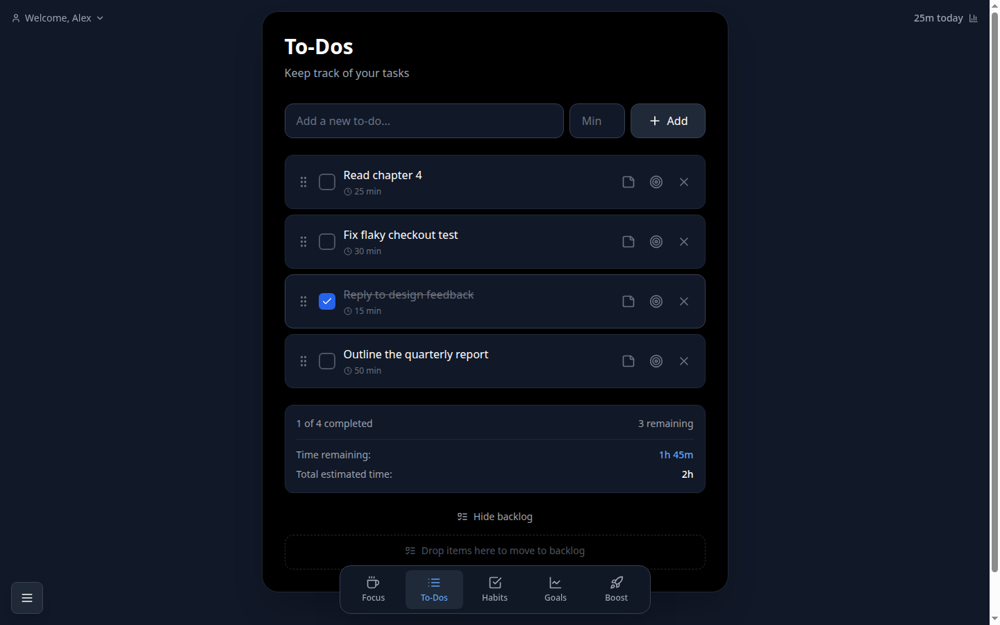
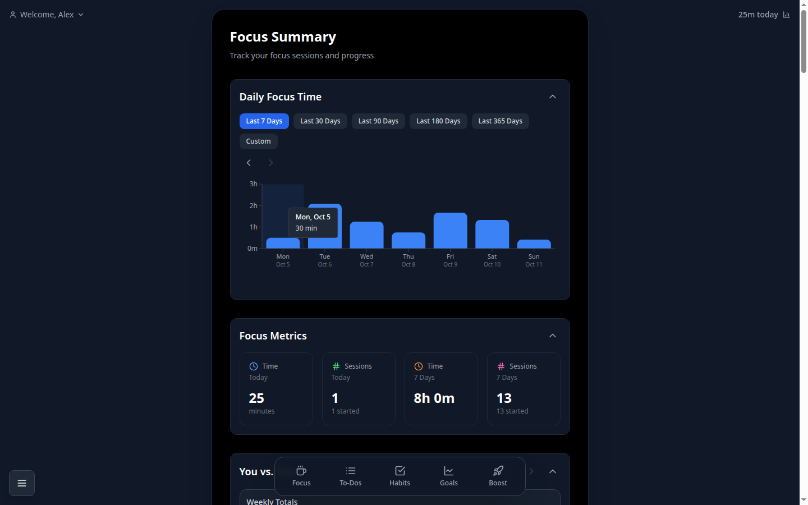
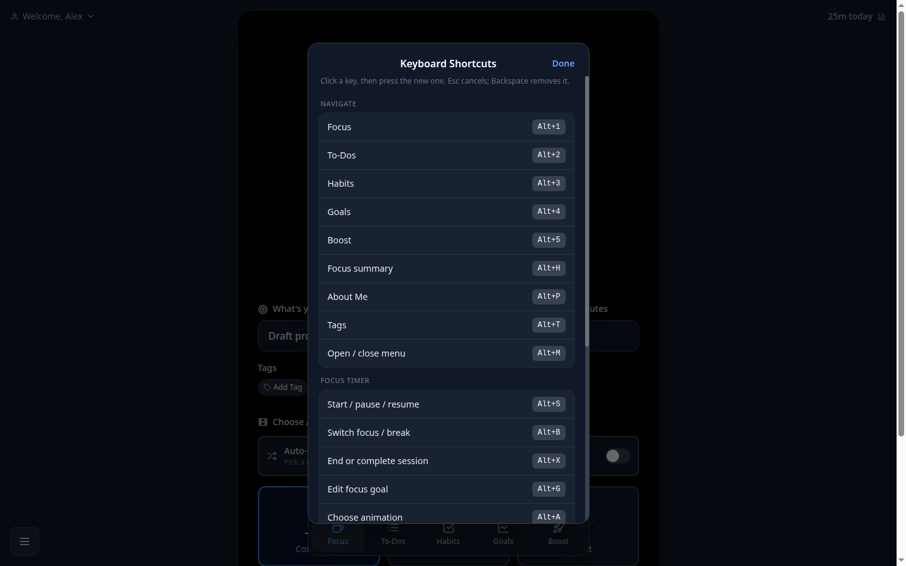

<div align="center">


# Boost Focus Timer

A calm, keyboard-friendly focus timer with to-dos, habits, goals and session history.
Runs as a web app or as a browser extension, and keeps every bit of data in your own browser.

[](https://github.com/ttncode/boost-focus-timer/actions/workflows/ci.yml)




</div>

## What you get

- **Focus timer** with pause, resume, breaks, extend-on-complete and goal history (press <kbd>↑</kbd>/<kbd>↓</kbd> in the goal field).
- **Notifications** when a focus session or break runs out. The app asks for permission with Chrome's own prompt the first time you open it; **Menu → Settings → Notifications** shows the current state and asks again if you dismissed the prompt. If nothing appears, allow notifications for your browser in your system settings and turn off Do Not Disturb / Focus.
- **Sound themes**: Classic (default), Glass, Wood, Singing bowl, Soft or Silent, each covering start, finish, break, back to work, pause, resume and button taps. Preview and pick them in **Menu → Settings → Sounds**. All sounds are synthesized in the browser.
- **Pixel-art progress animations** — a coffee cup that fills, a battery that charges, a rocket that lifts off — plus an auto-shuffle option.
- **To-dos** with time estimates, notes, drag-and-drop ordering, a backlog and archive; start a focus session straight from a to-do.
- **Habits** with 7- and 30-day grids and notes per day.
- **Goals** with target dates, comments and archive.
- **Focus summary**: daily focus chart, metrics, week-over-week comparison, time by tag and an editable session log.
- **Boost**: a private feed of notes, links, images and videos to keep yourself motivated.
- **Configurable keyboard shortcuts** for every main action, with an in-app editor (<kbd>Ctrl</kbd>+<kbd>/</kbd>).
- **No account, no server, no tracking.** Everything is stored in `localStorage` on the device you use.

| Choose an animation | Plan the day | See your progress |
| --- | --- | --- |
|  |  |  |

## Quick start

Requirements: **Node.js 24 or newer** (see `.nvmrc`) and npm.

```bash
git clone https://github.com/ttncode/boost-focus-timer.git
cd boost-focus-timer
npm ci
npm run dev
```

Open <http://localhost:3000>. To serve an optimized build instead, run `npm run build && npm start`.

## Install as a browser extension

The extension is the same app packaged for Chromium-based browsers (Chrome, Edge, Brave, Opera).

```bash
npm run build:extension
```

This writes an unpacked extension to `dist/extension/` and a zip to `dist/boost-focus-timer-extension-<version>.zip`.

1. Open `chrome://extensions` (or `edge://extensions`) and turn on **Developer mode**.
2. Click **Load unpacked** and select `dist/extension`.
3. Click the toolbar icon to open the timer in a tab. Clicking again focuses the existing tab instead of opening a second timer.
4. Optional: assign a global shortcut for **Open Boost Focus Timer** at `chrome://extensions/shortcuts`.

Extension data lives in the extension's own storage, separate from the web app's. Firefox is not supported yet.

## Keyboard shortcuts

Press <kbd>Ctrl</kbd>+<kbd>/</kbd> to open the shortcut list. Click a key to change it, press the new combination, <kbd>Esc</kbd> to cancel or <kbd>Backspace</kbd> to remove it. **Reset All to Default** restores everything. Assigning a combination that is already in use moves it to the new action.

| Group | Action | Default |
| --- | --- | --- |
| Navigate | Focus · To-Dos · Habits · Goals · Boost | <kbd>Alt</kbd>+<kbd>1</kbd> … <kbd>Alt</kbd>+<kbd>5</kbd> |
| | Focus summary | <kbd>Alt</kbd>+<kbd>H</kbd> |
| | About Me · Tags | <kbd>Alt</kbd>+<kbd>P</kbd> · <kbd>Alt</kbd>+<kbd>T</kbd> |
| | Open / close menu | <kbd>Alt</kbd>+<kbd>M</kbd> |
| Focus timer | Start / pause / resume | <kbd>Alt</kbd>+<kbd>S</kbd> |
| | Switch focus / break | <kbd>Alt</kbd>+<kbd>B</kbd> |
| | End or complete session | <kbd>Alt</kbd>+<kbd>X</kbd> |
| | Edit focus goal · Choose animation | <kbd>Alt</kbd>+<kbd>G</kbd> · <kbd>Alt</kbd>+<kbd>A</kbd> |
| | Add tag | <kbd>Alt</kbd>+<kbd>Shift</kbd>+<kbd>T</kbd> |
| Lists | New item on the current page | <kbd>Alt</kbd>+<kbd>N</kbd> |
| | Post to Boost · Attach media | <kbd>Ctrl</kbd>+<kbd>Enter</kbd> · <kbd>Alt</kbd>+<kbd>U</kbd> |
| App | Edit display name | <kbd>Alt</kbd>+<kbd>Shift</kbd>+<kbd>N</kbd> |
| | Show or hide the shortcut list | <kbd>Ctrl</kbd>+<kbd>/</kbd> |

Shortcuts without <kbd>Ctrl</kbd>, <kbd>Alt</kbd> or <kbd>Meta</kbd> are ignored while you type in a field. Hover a button to see its current shortcut. On Linux, Chrome reserves <kbd>Alt</kbd>+<kbd>1</kbd>…<kbd>8</kbd> for switching tabs; rebind those if they clash.

<div align="center">

</div>

## Your data

All records — sessions, tags, to-dos, habits, goals, posts and settings — are kept in this browser's `localStorage` under keys starting with `bft:`.

- Nothing is uploaded, and there is no sync between browsers or devices.
- Clearing site data for the app (or removing the extension) deletes everything.
- Images or videos attached to Boost posts are shown for the current session only; after a reload the post keeps its text.

## Development

| Command | What it does |
| --- | --- |
| `npm run dev` | Start the dev server on port 3000 |
| `npm run lint` | ESLint |
| `npm run typecheck` | TypeScript, no emit |
| `npm test` | Unit tests with Node's built-in test runner (`tests/`) |
| `npm run build` | Production build (standalone server output) |
| `npm run build:extension` | Static export packaged as a Manifest V3 extension |
| `npm run icons` | Regenerate the app and extension icons from the pixel grid in `scripts/generate-icons.mjs` |
| `npm run check` | Lint, typecheck, test and build — the same gate CI runs |

Project layout:

```text
src/app/               Next.js routes, root layout, icons and web manifest
src/components/        The app: shell, focus timer, pages, Boost feed, hotkeys
src/components/lib/    localStorage data layer (local-db) and session helpers
extension/             Extension service worker
scripts/               Icon generator and extension build
tests/                 Unit tests
```

Built with Next.js 16, React 19, TypeScript, Tailwind CSS 4, dnd-kit and Recharts.

## Status

Personal project, used daily by its author. The coffee-cup animation frames in `public/animations/coffee-cup/` are third-party artwork kept for private, personal use only; do not redistribute them. Not affiliated with any company or product of a similar name. There is no open-source license yet, so all rights are reserved; ask before reusing the code.
